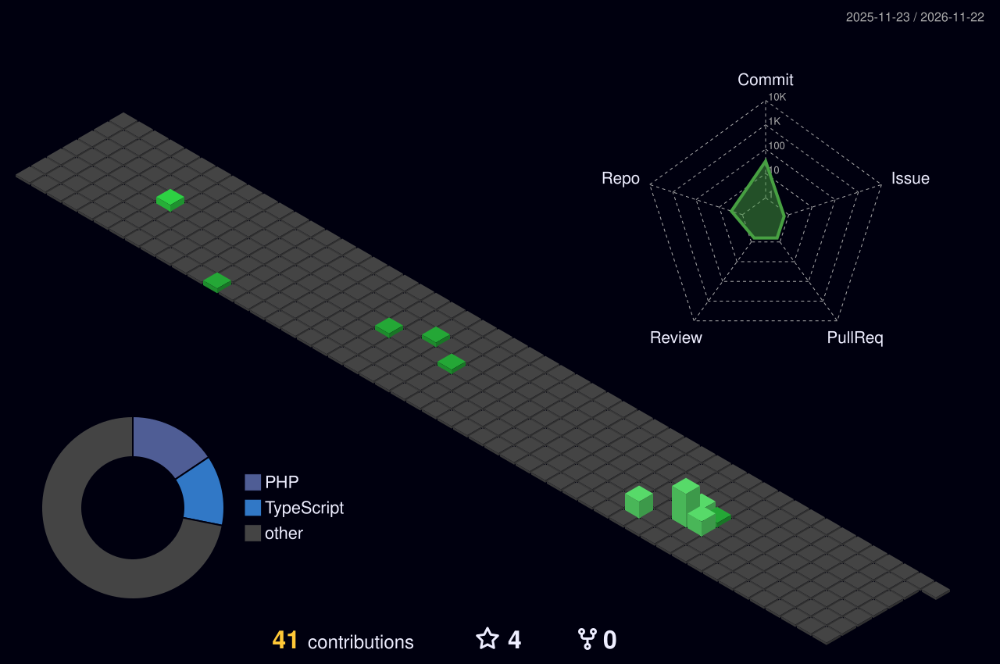

<h1 align="center">Hi 👋, I'm Azkaame</h1>

  

  

---

## 📌 About Me

I'm a web developer who enjoys building clean, responsive, and user-centered digital experiences. I focus on writing structured, maintainable code and turning ideas into working web applications.

Outside of code, I'm into **photography and videography**, especially visual storytelling and creative content production.

**🧠 Focus areas:** Full Stack Development · Web Development · Photography & Videography

---

## 🛠️ Tech Stack

| | |
|:--|:--|
| **Frontend** |  |
| **Backend** |  |
| **Database** |  |
| **DevOps & Cloud** |  |
| **Tools** |  |

---

## 📊 GitHub Stats

  

  

  

<picture>
  <source media="(prefers-color-scheme: dark)" srcset="https://raw.githubusercontent.com/Azkaame/Azkaame/output/github-snake-dark.svg" />
  <source media="(prefers-color-scheme: light)" srcset="https://raw.githubusercontent.com/Azkaame/Azkaame/output/github-snake.svg" />
  
</picture>
